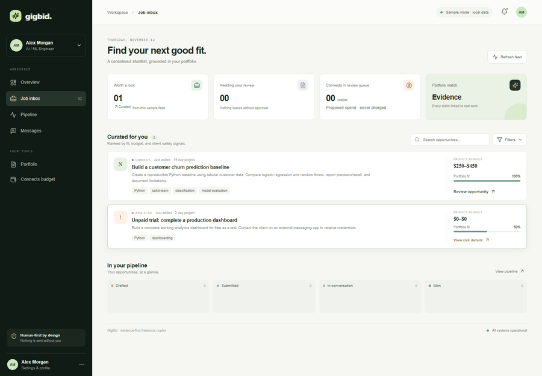
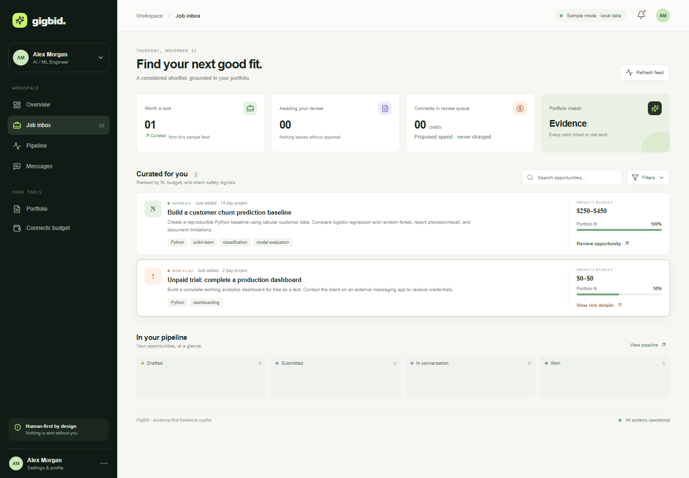
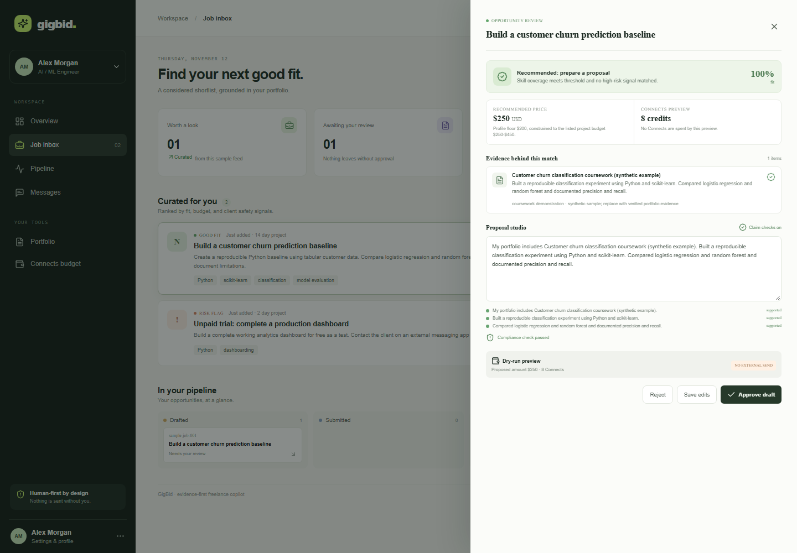
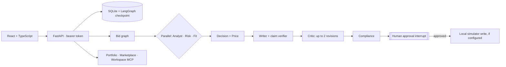

<p align="center">
  
</p>

# GigBid — Evidence-first Freelancer Copilot

GigBid screens jobs, flags unsafe requests, matches them to portfolio evidence, and drafts proposals
for human review. The optional local simulator can persist approved proposals and generate synthetic
client outcomes. The instructor's GigSim, persona/evaluation sets, policy update, and live OAuth
credentials were not included.

> **Safety note:** real marketplace writes are disabled. When configured, an explicit approval
> submits only to the local GigSim-style simulator and spends fictional simulator Connects. It is
> not connected to Upwork or the instructor's GigSim.

## Live deployment

- **Web app:** [genuine-art-production.up.railway.app](https://genuine-art-production.up.railway.app/)
- **API health:** [gig-bid-production.up.railway.app/health](https://gig-bid-production.up.railway.app/health)

The hosted app currently uses the bundled synthetic sample jobs and a single API bearer token.
It is not connected to the instructor's simulator, hidden evaluation data, or Upwork. Keep the
reviewer token out of this repository and provide it only through the private Classroom comment.

## Screens

### Inbox and recommendation


### Evidence-backed proposal review and approval


Regenerate the 30-second walkthrough with `python -m evals.runners.render_demo_gif`.

If screenshots are missing in a fresh checkout, start the API and React app using
[Getting Started](docs/GETTING_STARTED.md), then recreate them locally.

## Architecture



See [Architecture](docs/ARCHITECTURE.md), [MCP tools](docs/TOOLS.md), and
[deployment/service setup](docs/DEPLOYMENT.md).

## Evaluation results

Generated locally by `python -m evals.runners.run_demo_eval`; source metrics:
[`evals/results/demo_eval.json`](evals/results/demo_eval.json). The dataset is two bundled synthetic
jobs and one evidence item, not the instructor dev/hidden set. This tiny set is a smoke test only.

| Variant | Evidence Recall@5 | nDCG@10 | Unsupported claims / proposal | Judge score | Reply rate | p95 latency | Cost / proposal |
|---|---:|---:|---:|---:|---:|---:|---:|
| V0 token-vector cosine | 1.00 | 1.00 | N/A per variant | N/A | N/A | N/A per variant | N/A |
| V1 requirement decomposition | 1.00 | 1.00 | N/A per variant | N/A | N/A | N/A per variant | N/A |
| V2 hybrid RRF (current) | 1.00 | 1.00 | 0.00* | N/A | N/A | See results JSON** | No API; local cost unmeasured |
| V3 lexical reranking | 1.00 | 1.00 | N/A per variant | N/A | N/A | N/A per variant | N/A |
| V4 outcome-aware | 1.00 | 1.00 | N/A per variant | N/A | N/A | N/A per variant | N/A |
| V8 corrective retrieval | 1.00 | 1.00 | N/A per variant | N/A | N/A | N/A per variant | N/A |

`*` One proposal from the shipped V2 pipeline; this is not a per-variant ablation.  
`**` Combined in-process retrieval p95 across six calls, not end-to-end proposal latency.

Decision and scam-detection F1 are both 1.00 on the two local examples. The measured in-process
retrieval p95 is reported in the results JSON; it is not end-to-end latency. Before/after unsupported
claims are both 0.00 per proposal in the one locally drafted proposal. A separate local synthetic
simulator experiment follows; those generated outcomes are not marketplace evidence.

### Local synthetic simulator outcomes

The simulator evaluates 50 eligible postings from a deterministic 1,000-posting Kaggle-derived
candidate pool. It compares a generic template with the evidence-grounded draft against the
simulator's deterministic synthetic client preferences. This is a simulator sanity test, not a
valid real-client A/B experiment.

| Draft strategy | Simulated proposals | Synthetic reply/interview/hire rate | Synthetic hire rate |
|---|---:|---:|---:|
| Generic template | 50 | 16% | 6% |
| Evidence-grounded draft | 50 | 82% | 66% |

These are synthetic rule-generated outcomes, designed in part to reward relevance and personalization.
They must not be interpreted as expected Upwork reply or hire rates. The full breakdown is
[`evals/results/gigsim_eval.json`](evals/results/gigsim_eval.json); methodology and caveats are in the
[R&D report](docs/RND_REPORT.md).

### X5 negotiation coach

The review-only negotiation subgraph parsed and checked 40 authored offers across three synthetic
personas. Walk-away precision/recall were both 1.00 on five cases, with zero below-floor counters.
The deterministic synthetic buyer rule accepted 22 of 35 actionable offers/counters (62.9%); mean
achieved rate change on accepted cases was +11.1% versus the initial offer. This is not a real-client
acceptance estimate; see [`evals/results/negotiation_eval.json`](evals/results/negotiation_eval.json).

### Agent architecture comparison

| Architecture | Result |
|---|---|
| Hand-written LangGraph | Runs parallel analysis and persists/resumes the approval interrupt; tested on sample cases |
| Single ReAct agent | Not implemented or compared |
| Prebuilt supervisor | Not implemented or compared |

This is not a measured quality comparison. The deployed URL is live, but three public traces, a
three-minute demo video, and the external technical article are still pending. See the report and
deployment guide for the limitations.

## Run locally

```powershell
python -m pip install -e ".[dev]"
$env:GIGBID_API_TOKEN = "set-a-long-random-local-token"
uvicorn apps.api.main:app --reload --port 8000
```

In another terminal:

```powershell
cd apps\web
npm ci
npm run dev
```

Open `http://localhost:5173`, enter the API token, and inspect the sample jobs. To include the
locally downloaded Kaggle postings and run the local simulator, see
[Getting Started](docs/GETTING_STARTED.md). For Docker, see [Runbook](docs/RUNBOOK.md).

## Assignment deliverables

- [R&D report](docs/RND_REPORT.md).
- [Technical write-up draft](docs/TECHNICAL_WRITEUP_DRAFT.md) and
  [three-minute recording script](docs/DEMO_SCRIPT.md); both still need owner review/publication.
- [Portfolio MCP run/install guide](mcp_servers/portfolio/README.md) documents installation from
  this public GitHub repository with `uvx`; there is no PyPI release.

## Repository

Public source: [github.com/FatikImran/gig-bid](https://github.com/FatikImran/gig-bid).

## Known gaps

See [Implementation Checklist](docs/IMPLEMENTATION_CHECKLIST.md). In particular, the local
simulator uses deterministic synthetic client preferences/outcomes, not the instructor's hidden
simulator; the Kaggle-derived seed is local and ignored by Git. The deployed app currently has no
simulator service configured, so its approval preview does not send externally. Neural dense
retrieval, OAuth authorization, GitHub MCP, production multi-user identity, hosted tracing, three
public traces, the three-minute demo video, and external publication of the technical write-up
remain incomplete. The Messages screen accepts manually entered messages rather than loading an
inbox; Agent runs shows minimal audit events rather than streamed traces; Portfolio has no
upload/GitHub ingestion; and Settings does not enforce a weekly Connects budget.
