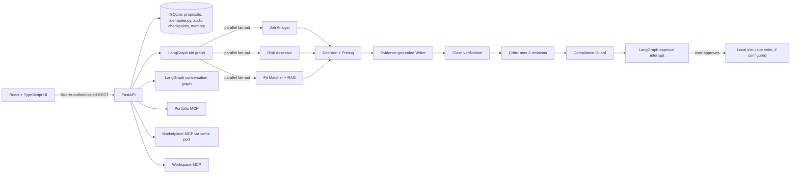

# GigBid architecture

## What is implemented

The graphs use a SQLite LangGraph checkpointer. The proposal and conversation approval routes resume
their interrupted thread after checking that the current state is at the approval node. With the
local GigSim service configured, an approval submits only to that simulator and may spend fictional
Connects. No request is sent to Upwork; its OAuth credentials are not configured.

## Boundaries and state

- **Thread state:** current job/conversation analyses, evidence, decision, price, draft, critique,
  compliance result and approval.
- **Execution/audit records:** tenant-scoped API event, trace/thread ID, event kind and minimal job
  or proposal identifier. Message content and credentials are not copied into the audit table.
- **Long-term memory:** separately stored style and outcome entries; raw tool results are never
  promoted. Style requires at least three consistent user edits; outcome requires a verified
  marketplace outcome and explicit user approval.
- **Local simulator:** `gigsim/app.py` (module `gigsim.app`) implements a local REST marketplace,
  synthetic client profiles/outcomes, Connects, idempotency, rate limits, and SQLite audit state.
  The API approval routes and Marketplace MCP reads use the configured marketplace port; only the
  API resumes the approval interrupt and performs simulator writes.
- **Marketplace port:** `agent/marketplace_port.py` has a local sample adapter and an official
  Upwork MCP client scaffold. The live adapter is read-only until its OAuth scopes and tool schema
  are verified.

## RAG decision

The runnable comparison has V0 token-vector cosine, V1 requirement decomposition, V2 BM25/token
cosine reciprocal-rank fusion, V3 lexical reranking, V4 outcome-aware ranking and V8 corrective
retrieval. Since only one evidence item is bundled, all variants tie on one positive retrieval query.
This is not enough evidence to claim an improvement. The current pipeline ships V2 as a deterministic
local baseline, not a measured production winner. Neural embeddings and cross-encoder reranking remain
unimplemented.

## Security and failure behavior

The API uses a bearer token, parameterized SQLite queries, tenant filters, bounded request models,
input lengths, idempotency keys on approvals, a durable audit record, and a rate-limited local
marketplace tool. Content is treated as untrusted data and rule matches cannot execute its embedded
instructions. Compliance blocks guarantees, off-platform contact and drafts without evidence.
The deployment uses a single-user token and SQLite; it is a local evaluation product, not a
multi-user production SaaS. Use HTTPS, a managed database, proper identity/OAuth, secret rotation,
backups and operational tracing before exposing it publicly.
