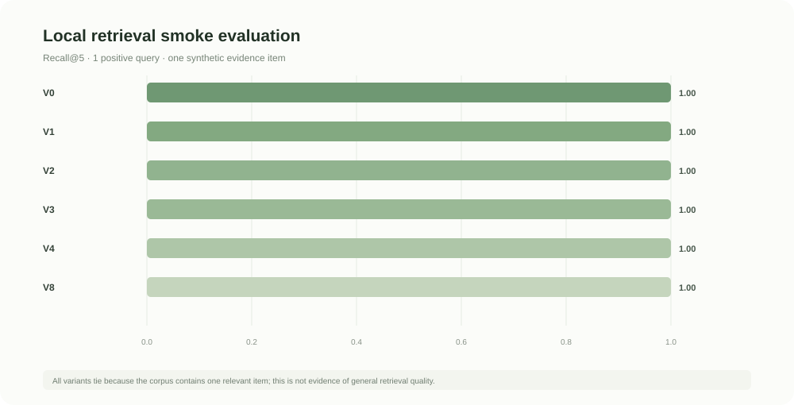

# GigBid — Research and Development Report

**Course:** AI-4016 · Assignment 2  
**Student:** Muhammad Fatik · **Roll number:** 23I-0655 · **Section:** A  
**Report date:** 12 November 2026  
**Status:** Public Railway prototype is live in sample mode; this is not a deployed instructor GigSim submission.

## Executive summary

GigBid is an evidence-first freelancer copilot. It screens starter examples and an optional
Kaggle-derived feed, flags unpaid/off-platform or injected instructions, retrieves persona evidence,
drafts proposals, verifies claims, and waits for human approval. A hand-written LangGraph bid
workflow fans out the Job Analyst, Risk Assessor and Fit Matcher in parallel, then runs pricing,
writing, claim verification, a bounded Critic, compliance, and a persisted interrupt. A local
GigSim-style REST service stores approved simulator proposals, fictional Connects, messages, and
deterministic synthetic client outcomes. It is our substitute, not the instructor's service.

The local feed is prepared from 200 selected historical postings and 40 authored synthetic safety
scenarios; raw CSVs and derived seed are excluded from Git. Three fictional personas and all
generated client preferences/outcomes are explicitly synthetic. The instructor's GigSim, persona
corpora, gold/hidden evaluations, and updated policy are not in the workspace. Therefore retrieval
smoke metrics and local simulator outcomes are distinct, and neither demonstrates real marketplace
performance. Results are in [`evals/results/demo_eval.json`](../evals/results/demo_eval.json) and
[`evals/results/gigsim_eval.json`](../evals/results/gigsim_eval.json).

## 1. Problem and constraints

Freelancers spend time triaging listings and risk Connects on poor-fit or unsafe work. GigBid should
reduce that effort without impersonating the freelancer. The system must never follow instructions
embedded in untrusted job/client text, invent experience, contact clients off-platform, or send a
proposal/message or spend Connects without approval. The app never writes to a real marketplace. When configured, explicit approval submits only to the
local simulator and spends fictional Connects.

Three fictional profiles and authored synthetic portfolio items are available for local fit tests.
`data/sample/jobs.json` still provides one plausible job and one unpaid off-platform trial. The
optional Kaggle feed supplies historical job descriptions; the contract dataset provides only
descriptive aggregates and does not train a pricing model. Simulator reply/hire outcomes follow
synthetic deterministic rules, not real client behavior.

## 2. Architecture and implementation

FastAPI protects the application with a bearer token. SQLite stores proposals, status changes,
idempotency records, audit events, promoted memories, worker-seen job IDs, and LangGraph checkpoints.
The hand-written bid graph uses `Send` for parallel analysis. A decision node sends risky/low-fit jobs
to a terminal state; bid candidates proceed to price, writer, verifier, critic (at most two
revisions), compliance, and `interrupt()` for human review. The API approval endpoint resumes the
checkpoint after a restart; the integration test covers close/reopen before approval. Edits are
re-checked and copied into graph state before resumption.

The conversation graph classifies question, negotiation, interview request, scam signal, or other,
then interrupts before approval. The API can send an explicitly approved draft only to the
configured local simulator. Direct non-dry-run Marketplace MCP calls are rejected, even when passed
`approved=true`; only the authenticated API's persisted approval workflow can reach simulator
writes. The same API bearer credential maps to a single local tenant; this is not multi-user
authentication or encrypted OAuth storage.

The local `gigsim.app` FastAPI service wraps the generated job/client seed and persists proposals,
messages, Connects, idempotency results, and audit metadata in SQLite. Synthetic hidden preferences
are not exposed through client-history responses. Deterministic rules produce ignored, replied,
interview, or hired proposal outcomes; requests are rate limited and a transient failure is
occasionally injected. The GigBid approval endpoint only permits local simulator hostnames and
calls the service after approval resumes. Three local FastMCP servers expose typed portfolio, configured-marketplace, and workspace tools.
Marketplace reads use the configured port; write-intent calls only preview and reject non-dry-run
requests. Upwork OAuth authorization/callback, live writes, and a separate GitHub MCP server are not
implemented.

The React UI supplies Pipeline, Messages, Agent runs, Analytics, Portfolio, and Settings sections,
along with job/risk/evidence review, proposal editing, approval/rejection, and Connects preview.
Local simulator submission is distinguished from real marketplace activity. Important limitations
remain: Messages accepts user-entered messages rather than reading a client inbox; Agent runs shows
minimal audit events rather than streamed node traces; Portfolio has no upload/GitHub ingestion; and
Settings does not enforce a weekly Connects budget. See
[the implementation checklist](./IMPLEMENTATION_CHECKLIST.md).

## 3. R&D question A — MCP tool design

**Question:** does tool granularity and description quality change tool selection or arguments?
**Experiment status:** not measured. The required 40-task tool-selection benchmark and known correct
calls are still absent. The 40 synthetic risk scenarios test policy behavior, not tool selection.
We do not claim tool-selection accuracy, argument accuracy, or token counts.

What was verified is narrower: local FastMCP tools are typed, bounded, and annotated; in-memory
MCP client tests exercise listing and calls; a schema snapshot fails CI on tool-contract changes;
portfolio search returns synthetic evidence; marketplace tools use the configured port; and write
previews reject missing approval. The simulator REST API rejects unapproved actions and handles
idempotency; workspace holds reject unapproved requests. These checks are not a substitute for a
model-based tool-selection study. The exact tool surface is listed in
[`docs/TOOLS.md`](./TOOLS.md).

## 4. R&D question B — retrieval and claim verification

**Exploratory hypothesis:** requirement decomposition and hybrid lexical ranking will be no worse
than token-vector cosine on the bundled sample labels. This small corpus cannot support a
generalization claim. V0, V1, V2, V3, V4, and V8 were run by
`python -m evals.runners.run_demo_eval`; no neural model or network API was used.

| Variant | Evidence Recall@5 | MRR | nDCG@10 | Positive queries |
|---|---:|---:|---:|---:|
| V0 token-vector cosine | 1.00 | 1.00 | 1.00 | 1 |
| V1 requirement decomposition | 1.00 | 1.00 | 1.00 | 1 |
| V2 BM25/token-cosine RRF | 1.00 | 1.00 | 1.00 | 1 |
| V3 lexical reranking | 1.00 | 1.00 | 1.00 | 1 |
| V4 outcome-aware ranking | 1.00 | 1.00 | 1.00 | 1 |
| V8 corrective retrieval | 1.00 | 1.00 | 1.00 | 1 |

The baseline smoke test deliberately retains one evidence item and one positive query, so the tie is
uninformative. The current pipeline selects V2 for deterministic exact-term behavior; it is not
established as a quality winner. Three synthetic portfolios are now available for end-to-end fit,
but no gold evidence labels, multi-persona retrieval benchmark, ablation, blind proposal panel, or
calibrated LLM judge has been run. Cohen's kappa is therefore not applicable.

On the one bid-eligible sample job, the proposal had **0 unsupported sentences before and 0 after**
the verifier. This is a one-proposal sample and does not establish a general hallucination rate. The
checker uses conservative token overlap against the included evidence and removes any sentence below
its support threshold; semantic entailment is not guaranteed. The current result file records
retrieval p95 over six in-process retrieval calls; this is not
end-to-end latency and excludes API, graph, model, and marketplace time. No paid API was called;
token usage and production USD/job are not applicable. A separate local simulator evaluation now
reports deterministic reply/hire outcomes for eligible proposals, but those are generated labels
and are not real client outcomes.

### Synthetic client outcome comparison

`python -m evals.runners.evaluate_gigsim` selected 50 eligible postings from a deterministic
hash-ordered, 1,000-row cap of the Kaggle-derived corpus. For each, the best-fitting eligible
synthetic persona submitted two drafts to the deterministic outcome rule: a generic template and
the current evidence-grounded draft. The local rule counts interview and hire as replies.

| Draft | Proposals | Reply/interview/hire | Hire |
|---|---:|---:|---:|
| Generic template | 50 | 16% | 6% |
| Evidence-grounded draft | 50 | 82% | 66% |

This large difference is expected in part because the simulator explicitly rewards job relevance,
preferred terms, and personalized openings. It is an implementation/sanity check, not an independent
experiment or estimate of real client behavior. The 40 synthetic unpaid/off-platform and injection
fixtures were all skipped (40/40); they were authored to exercise those existing safety rules, so
this is not general scam recall. Full counts and limitations are in
[`evals/results/gigsim_eval.json`](../evals/results/gigsim_eval.json). The baseline retrieval smoke
runner separately leaves reply/hire values null; it does not call the simulator.

## 5. R&D question C — orchestration

**Question:** is the multi-agent graph worth it versus one ReAct agent or a prebuilt supervisor?
**Experiment status:** the required comparison of a single ReAct agent, prebuilt supervisor, and
hand-built graph is not run. The local simulator and a deterministic 50-eligible-job draft-style
comparison now exist, but that is not an architecture comparison and its outcomes are synthetic.

The hand-written graph's functional behavior was tested: its analysis branches run in parallel, a
safe sample reaches the proposal approval interrupt, a risk signal exits before approval, and a
checkpoint resumes after the API test client is restarted. The Python suite includes these
integration paths. The implementation is justified here for policy boundaries and explicit state,
not by evidence that it produces better client outcomes than a single agent.

## 6. Change request, memory, and signature extension

The assignment describes a 2 November 2026 policy update, but that updated policy file was not in the
workspace. The local policy is therefore the illustrative starter policy, not the grading source of
truth. Risk terms and prohibited terms now live in `data/policy_pack/policy.yaml`, fit/risk thresholds
and RAG selection live in `agent/config.yaml`, and each agent prompt is a separate file. Applying a
future rule can be localized to that policy file plus focused tests. We cannot report the actual
instructor update, measured edit time, or line count.

Style memory promotion requires at least three consistent user edits; outcome memory requires a
verified marketplace result and explicit user approval. The SQLite store separates style and outcome
records by tenant and allows listing/deletion. Raw tool output is not promoted. This memory flow is
not yet exposed through a settings UI.

The selected extension is an **X5 negotiation coach**. Negotiation messages pass through an offer
parser, persona-specific floor and listing-ceiling rules, and a response drafter before the existing
human-review interrupt. In 40 authored synthetic offers, walk-away precision and recall were both
1.00 on five floor/ceiling conflict cases, and no counteroffer fell below the selected profile floor.
A deterministic synthetic buyer rule accepted 22 of 35 actionable offers/counters (62.9%); the mean
accepted rate change versus the initial offer was +11.1%. These figures describe only the authored
simulator rule, not real client negotiations or GigSim. The complete result and caveats are in
[`evals/results/negotiation_eval.json`](../evals/results/negotiation_eval.json) and
[`docs/EXTENSION.md`](./EXTENSION.md).

## 7. Failures, safety, and operations

Observed engineering failures and corrections:

1. Editable Python installation initially failed because setuptools discovered multiple top-level
   packages; explicit package discovery was added.
2. The first injection test showed an injected prompt signal below the skip threshold; policy-backed
   risk scoring now reaches the high-risk decision threshold.
3. API tests initially skipped application lifespan setup and failed to create proposal tables;
   tests now use the full lifespan and startup initializes both API tables and graph checkpoints.
4. Browser validation exposed a CORS-origin mismatch when opening the UI at `127.0.0.1`; supported
   local development uses the documented `localhost` origin.
5. TypeScript compilation initially failed because React declarations and Vite environment types
   were missing; those type dependencies/declarations were added.

These are implementation/debugging incidents, **not ten failed marketplace jobs**. To exercise
failure handling without inventing dev-set observations, `python -m
evals.runners.evaluate_failure_modes` runs twelve authored synthetic regression cases. All twelve
pass in the current result file, including bid/skip decisions, unsupported claims, compliance,
injection in jobs and messages, hourly/fixed pricing, idempotent retry, rate limiting, and injected
transient failures. The full case-by-case evidence is in
[`evals/results/failure_modes.json`](../evals/results/failure_modes.json). These are control tests,
not observed failures, and do not satisfy the requested ten failed instructor dev jobs.

The local protections include bearer authentication, parameterized DB queries, tenant filters,
bounded Pydantic requests, idempotency keys, persistent approval checkpoints, policy-configured
risk/compliance checks, PII masking helper, and fail-closed external actions. Audit records omit
message and proposal body text. The local worker polls conservatively and deduplicates job IDs.
There is no hosted tracing service, distributed queue, Postgres/Redis setup, or encrypted OAuth
store. The web app and API are deployed on Railway at
[genuine-art-production.up.railway.app](https://genuine-art-production.up.railway.app/) and
[gig-bid-production.up.railway.app](https://gig-bid-production.up.railway.app/health). The hosted
app uses the bundled synthetic examples, a shared API bearer token, and SQLite; it has no simulator
service configured and does not send externally. Health, CORS, the safe-job review, and the
high-risk skip path were smoke-tested. This is not an instructor GigSim deployment. The
single-user prototype should not be exposed as a production SaaS without the upgrades in
[`DEPLOYMENT.md`](./DEPLOYMENT.md).

## 8. Reproducibility and final outcome

At this report run, the Python suite passed **42 tests**, the Playwright suite passed **7 tests**, the
React production build succeeded, Ruff passed, and `docker compose ... config --quiet` passed. The
generated metrics and SVG figure can be reproduced locally. These checks do not replace the required
GigSim hidden test, private reviewer credential delivery, public traces, video submission, or
published technical write-up. The public app URL is live; its reviewer login must be shared only in
the private Classroom comment.

**What ships:** a prepared local Kaggle-derived feed, a distinct local deterministic simulator with
synthetic outcomes, approval-safe LangGraph graphs, SQLite checkpoints, three local MCP servers,
six lightweight RAG variants, claim filtering, and partial workspace UI screens. **What does not
ship:** live marketplace integration, instructor GigSim compatibility, neural embeddings/reranking,
multi-user production identity, architecture-comparison evidence, hosted tracing, or the remaining
message-inbox, portfolio-ingestion, and budget-enforcement workflows. The local GitHub-based
Portfolio MCP install guide is prepared, but there is no PyPI release.
This honest boundary is preferable to reporting invented performance.
